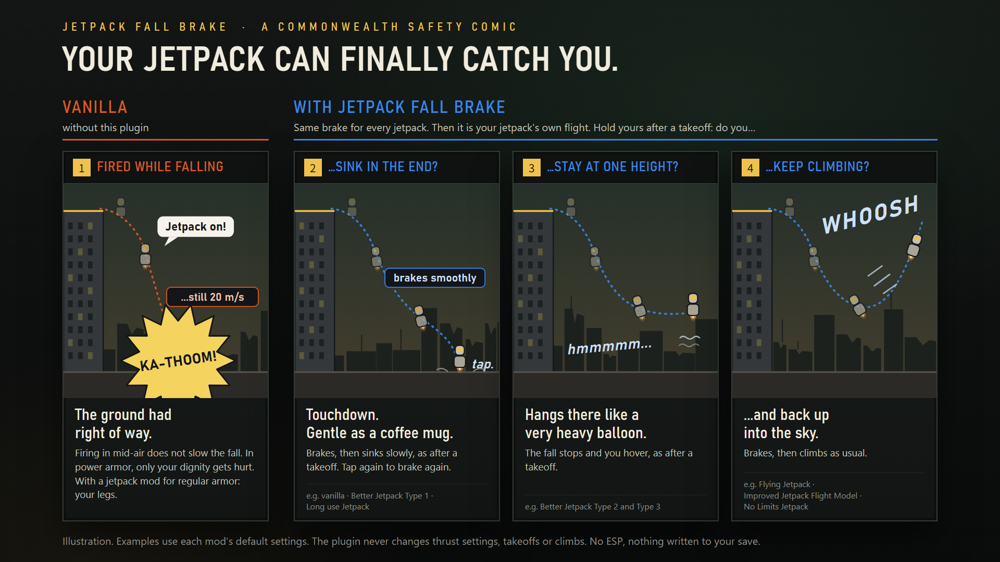
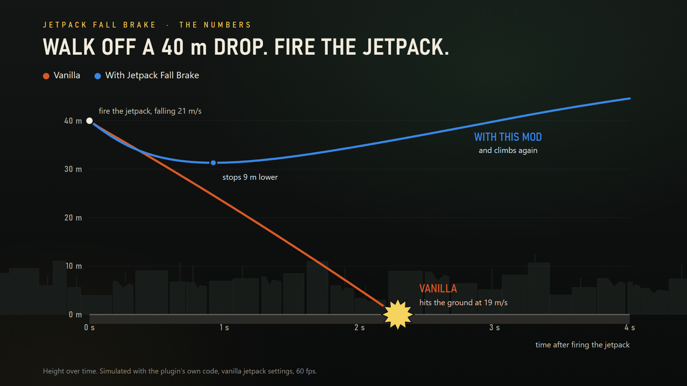
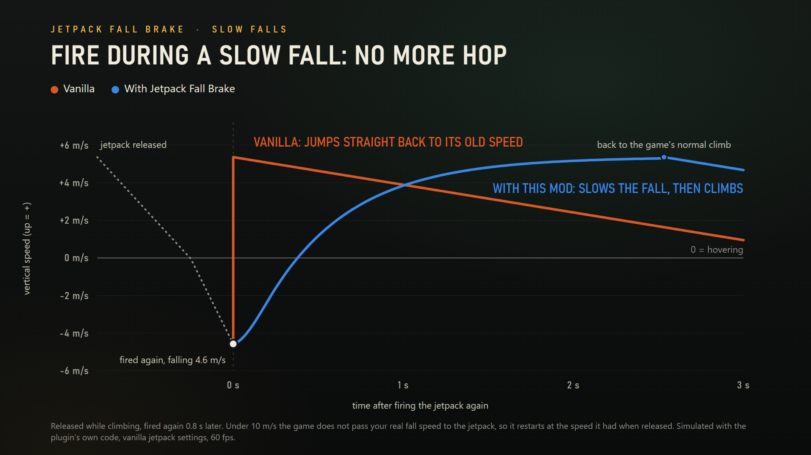
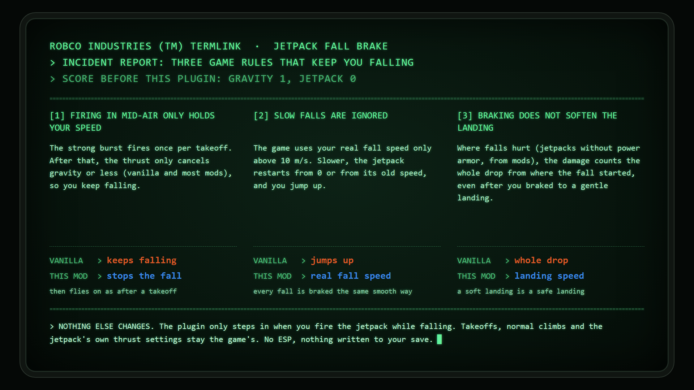
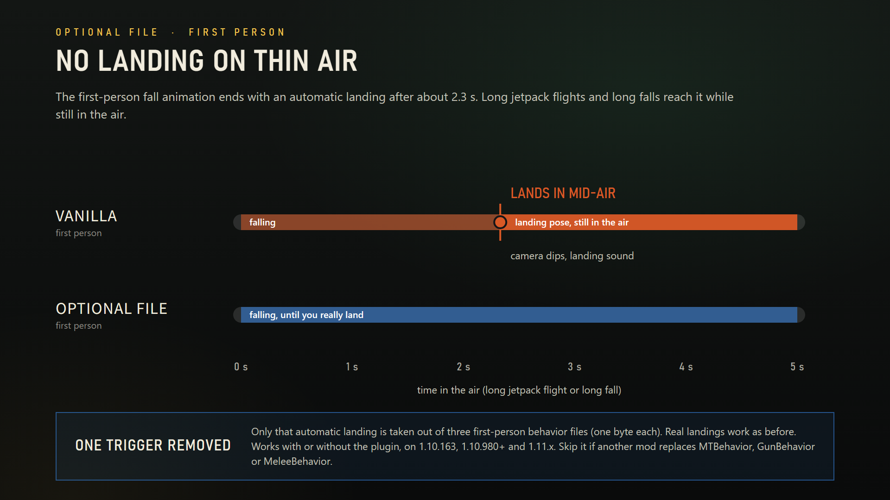

# Jetpack Fall Brake

<a href="https://www.nexusmods.com/fallout4/mods/111658"></a>
<a href="LICENSE"></a>
<a href="https://buymeacoffee.com/quoteproxy"></a>


An F4SE plugin for Fallout 4 (1.10.163, 1.10.980+ and 1.11.x). In vanilla, firing a jetpack while you fall
does not slow the fall: you keep falling at the same speed until you hit the ground. This goes for the power
armor jetpack and for jetpack mods for regular armor. With this plugin, firing the jetpack while falling
brakes the fall smoothly. After the brake, your jetpack flies on exactly as it does
after a takeoff, so depending on your jetpack (vanilla or a jetpack mod) you land softly, hover or climb
back up.

No ESP, nothing is written to your save. Takeoffs, climbs and the jetpack's thrust settings are not
changed. You can add or remove it at any time.

## What happens after the brake

The brake is the same for every jetpack. After it, the jetpack is handed back to the game at the speed a
takeoff from the ground gives, so it carries on as after a takeoff. Hold your jetpack after a normal
takeoff and see what it does:



| After a takeoff, holding the jetpack, you... | Firing it while falling, with this plugin | Default settings of |
|---|---|---|
| sink in the end | brakes, then sinks slowly; tap again to brake again | vanilla, Better Jetpack Type 1, Long use Jetpack |
| stay at one height | the fall stops and you hover | Better Jetpack Type 2 and Type 3 |
| keep climbing | brakes, then climbs back up | Flying Jetpack, Improved Jetpack Flight Model, No Limits Jetpack |

Tested in game with Flying Jetpack, on the power armor jetpack and on jetpacks for regular armor
(Armorsmith Extended, MS-06F Jetpack). The other rows are computed from each mod's default jetpack settings
with the plugin's own code.

## Results

In game: the same jump off the Mass Fusion building and the same input, vanilla on the left and this plugin
on the right ([video](https://youtu.be/xtg3yUf2H4o)).

Simulated with the plugin's own code, vanilla jetpack settings, 60 fps. Walking off a 40 m drop and firing
the jetpack, vanilla hits the ground at 19 m/s. With this plugin the fall stops 9 m lower and the jetpack
climbs again.



Fired again during a slow fall, the vanilla jetpack jumps back to the speed it had when it was released.
With this plugin it starts from the real fall speed and is braked like any other fall.



## Cause



This was found by reverse engineering `Fallout4.exe` 1.11.240 (from a runtime memory dump); 1.10.163 and
1.10.984 follow the same rules. The addresses below are the 1.11.240 ones. Three game rules keep you falling:

1. **Firing in mid-air only holds your speed.** Every frame the jetpack integrates its own vertical speed:
   `vz += (thrust - 100) * 6.8693 * dt`, so a thrust of 100 exactly cancels gravity. The thrust blends from
   `fJetpackThrustInitial` to `fJetpackThrustSustained` over `fJetpackTimeToSustained`, but with
   `bJetpackInitialThrustOnlyOnTakeoff` (default 1) the strong initial burst happens only once per
   takeoff. Fired again in mid-air, the jetpack runs at the sustained thrust: 85 in vanilla, 100 in some
   mods. That never slows a fall.
2. **Slow falls are ignored.** When the jetpack is fired in mid-air, the game copies the character's real
   vertical speed into the jetpack only if the character is in the air and falling faster than 700 units/s
   (10 m/s, a hardcoded constant in the check at `Fallout4.exe+C5BE80`). Otherwise the jetpack starts from 0
   (first firing after landing) or from the speed it had when it was last released, so firing during a
   slow fall jumps straight up.
3. **Braking does not soften the landing.** Fall damage is taken from the drop between the recorded fall
   start height and the landing height, not from the landing speed, and the jetpack never lowers that
   record. Power armor ignores fall damage, but jetpack mods for regular armor do not.

## How it is fixed

Three hooks, all found by byte pattern (no hardcoded addresses). The offsets are the 1.11.240 ones; the log
shows where they are on your version:

1. **Jetpack update** (`Fallout4.exe+B80D5D`). When the jetpack is fired while falling, a recovery starts.
   The thrust follows a smooth curve towards the climb speed V of a takeoff from the ground:

   `wanted acceleration = fBrakeAccel * sat((V - vz) / fEaseSpeed)`, with `sat(x) = x / (1 + x^4)^(1/4)`

   A fast fall gets the full deceleration, which eases off as the fall slows and carries on through
   vz = 0 without a pause. The acceleration builds up with a short spool-up (`fThrustRampTime`) and drops
   at once. When vz reaches V, the game's own thrust takes over, exactly as after a takeoff. During a
   recovery the thrust is never lower than the game's own value.
   - V comes from the game settings: the speed the takeoff burst gives at 60 fps (about 5 m/s in vanilla
     and with Flying Jetpack). A burst longer than 1 s counts only its first second. With an initial
     thrust at or near 100, V is about 0, so the recovery stops the fall and the jetpack hovers.
   - On the first firing after landing, the game's takeoff burst is still pending. The part of it above
     the thrust the game keeps afterwards is faded by the fall speed at firing: in full near vz = 0, gone
     at a fall of V, so a fast fall is not met by a sudden kick.
   - Takeoffs, firing again while still rising and the climb after a recovery are left to the game.
2. **Jetpack start** (`Fallout4.exe+B80685`). This one call to the start-speed check is redirected to a
   copy of it without the 700 units/s threshold, so every fall starts from the real fall speed
   (`bRealFallSpeed`). The other callers of the check are left alone.
3. **Fall start record** (`Fallout4.exe+B80F28`). While the jetpack fires downwards, the record is kept at
   "current height + the height a free fall needs to reach the current speed", so fall damage follows the
   landing speed (`bFallDamageFromSpeed`).

If a pattern is not found exactly once, that part is not patched and the reason is written to
`Documents\My Games\Fallout4\F4SE\JetpackFallBrake.log`.

## Optional: first person, no landing in mid-air



In first person, the fall animation (JumpFall) that the jetpack starts ends with an automatic `jumpLand`
trigger after about 2.3 s. Long jetpack flights and long falls reach it while still in the air: the camera
dips and a landing sound plays. The optional file on Nexus Mods removes only that trigger from the three
first-person behavior files (`MTBehavior.hkx`, `GunBehavior.hkx`, `MeleeBehavior.hkx`, one byte each).
Real landings work as before. It works with or without the plugin. The three files are the same in
1.10.163, 1.10.984 and 1.11.240, so the optional file fits all of them.

The behavior files are game assets, so they are not in this repository. `tools/patch_jumpfall.py` makes
them from your own game files (`Meshes\Actors\Character\_1stPerson\Behaviors\*.hkx`, extracted from
`Fallout4 - Animations.ba2`):

```
python tools\patch_jumpfall.py MTBehavior.hkx MTBehavior_patched.hkx
```

## Settings

`Data\F4SE\Plugins\JetpackFallBrake.ini`, section `[General]`, read when the game starts:

| key | default | meaning |
|---|---|---|
| `bEnabled` | 1 | 0 = install nothing |
| `bRealFallSpeed` | 1 | 1 = every fall starts from the real fall speed, 0 = the game's 700 units/s rule |
| `fClimbSpeed` | -1 | speed the brake eases into (units/s); -1 = the speed of a takeoff, from the game settings |
| `fBrakeAccel` | 3000 | strongest acceleration against a fast fall (units/s²; gravity is about 687) |
| `fEaseSpeed` | 1500 | speed range over which the push fades out; larger = gentler and longer |
| `fThrustRampTime` | 0.1 | spool-up time constant (s) when the push rises |
| `bFallDamageFromSpeed` | 1 | 1 = fall damage after using the jetpack follows the landing speed, 0 = the game's rule |

## Requirements

- Fallout 4 1.10.163 (before the Next Gen update), 1.10.980+ or 1.11.x
- [F4SE](https://f4se.silverlock.org/) for your game version: 0.6.23 for 1.10.163, 0.7.x for 1.10.980+ and
  1.11.x

## Compatibility

- Built and tested in game on Fallout 4 **1.11.240** (F4SE 0.7.9), **1.10.984** (F4SE 0.7.2) and
  **1.10.163** (F4SE 0.6.23).
- On other versions every patch first looks for the code it expects and turns itself off if it does not
  find it; check the log to see what was installed.
- Jetpack mods that change the jetpack game settings work: the plugin reads them from the game.
- If another plugin already changed the same code, that part is skipped and the log says so.

## Building

`build.bat` (Visual Studio 2022 or Build Tools 2022, x64). Output: `build\JetpackFallBrake.dll`, also copied
to `package\F4SE\Plugins\`.

## Changes

- **1.1.0**: Fallout 4 1.10.163 (before the Next Gen update) and 1.10.980+ (the first Next Gen release)
  support. Nothing changes on 1.11.x, so there is no need to update there.
- **1.0.0**: First release.

## Support

All my mods are free. If this one made your game better and you'd like to say thanks, you can [buy me a coffee](https://buymeacoffee.com/quoteproxy). There are no paid perks or early access.

## License

MIT. The plugin source and the tools are covered by it. The optional behavior files on Nexus Mods are
modified game files and are not.
